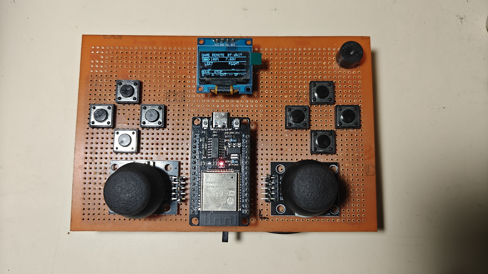
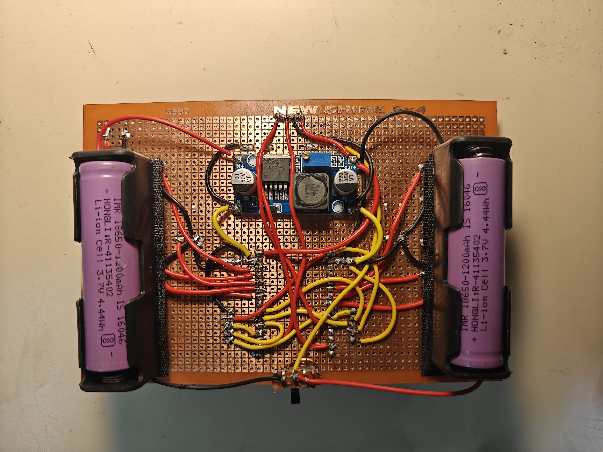
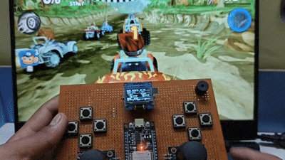

# 🎮 ESP32 Gaming Controller

An easy-to-build gaming controller made using readily available electronic components, designed to connect to a PC or laptop via Bluetooth. It provides a control experience similar to using a real RC controller. Since the microcontroller is programmable, users can customize the functions of each button and joystick movement according to their preferences, making the controller comfortable and convenient to use.

---

## 🎮 Features of ESP32 GamePad

- **📡 Bluetooth Connectivity:** Connect wirelessly to your laptop or PC via Bluetooth for a convenient gaming experience.
- **🔊 Buzzer for Gaming Effects:** Provides audio feedback and sound effects to enhance the gaming experience.
- **🖥️ OLED Display:** Displays important controller information, including button inputs and other real-time details.
- **⚙️ Programmable ESP32:** Customize button functions and joystick controls according to your preferences and the requirements of different games.
- **🎯 8 Push Buttons:** Provides multiple input buttons for flexible controls across different games and applications.
- **🔋 Battery Level Indicator:** Monitor the controller's battery level directly on the display.

---

## ⚒️ Hardware 
|Sr no. | Components | Quantity | Description | 
|---|---|---|---|
|1.|Analog Joystick module|2|X/Y axis + push button|
|2.|Push buttons|8|game controls|
|3.|Esp32 Deb Board|1|Programmable chip|
|4.|OLED Screen|1|Information depiction|
|5.|Buzzer|1|Gaming effect|
|6.|Female pin headers|2|to place components|
|7.|Lithium ion batteries|2|To power microcontroller|
|8.|Lithium ion holders|2|To place battery|
|9.|LM2596|1|Buck converter|
|10.|Sliding switching|1|For on/off|

---

## 📷 Hardware Photos

| Remote - Front |
|:---:|
|  |
| Remote - Back | 
|  |

---

## 🎬 Demo 

<div align="center" >

 

</div>

---

## 🚀 Getting Started

Follow these steps to build your own ESP32 GamePad and get it running!

### 🛠️ Step 1: Gather the Hardware Components

Collect all the electronic components listed in the [Hardware Requirements](#-hardware-requirements) section of this repository. Make sure you have all the required components before starting the assembly.

### 🔌 Step 2: Assemble the Controller

Connect the ESP32, joysticks, push buttons, OLED display, buzzer, and other components according to the circuit connections provided in this project. Double-check your wiring before powering on the controller to avoid damaging any components.

### 💻 Step 3: Get the Source Code

You can obtain the program in either of the following ways:

**Option 1: Clone the Repository (Recommended)**

If you have Git installed on your computer, open a terminal or Command Prompt and run:

```bash
git clone https://github.com/SohamKale83/ESP32_GamePad.git
```

Navigate to the cloned project folder:

```bash
cd ESP32_GamePad
```

You can now access the source code and other project files on your computer.

**Option 2: Download or Copy the Code Manually**

If you don't want to use Git, you can simply:

1. Open the [ESP32_GamePad GitHub repository](https://github.com/SohamKale83/ESP32_GamePad).
2. Download the project using **Code → Download ZIP**, then extract the ZIP file.
3. Open the `ESP32_GamePad` folder and locate the Arduino program (`.ino` file).
4. Open the program in the Arduino IDE.

Alternatively, if you already have the project folder on your computer, simply open it and copy the program into your Arduino IDE.

### ⚡ Step 4: Upload the Program

1. Install and open the Arduino IDE.
2. Install the required libraries mentioned in the project documentation.
3. Connect your ESP32 to your computer using a USB cable.
4. Select the appropriate ESP32 board and COM port in the Arduino IDE.
5. Open the `.ino` file, compile the program, and upload it to your ESP32.

### 🎮 Step 5: Connect and Play

Once the program has been uploaded, power on your controller and pair it with your laptop or PC through Bluetooth. Your ESP32 GamePad is now ready to use!

**💡 Customization Tip:** Since the ESP32 is programmable, you can modify the source code to change button functions, joystick controls, and other features according to your preferences and the games you want to play.

---

## 📁 Repository Structure

```
Remote-Controller/
├── docs/
│   └── images/
├── Gaming_Controller/
│   └── Gaming_Controller.ino
├── LICENSE
└── README.md

```

## 📄 License

This project is licensed under the MIT License — see the [LICENSE](LICENSE) file for details.

## 👤 Author

**Soham Kale**
GitHub: [@SohamKale83](https://github.com/SohamKale83)